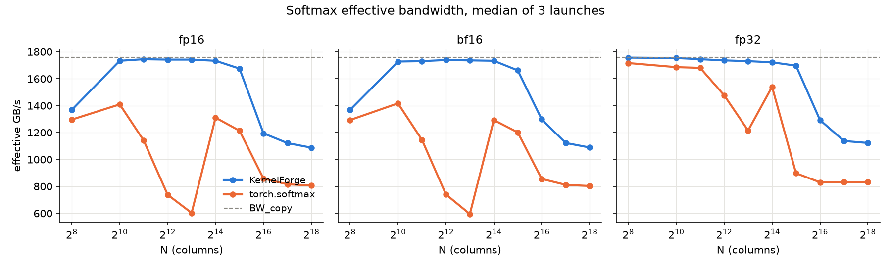
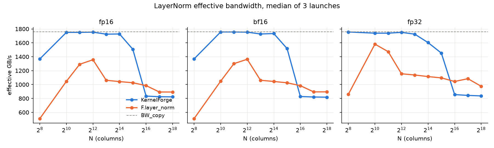
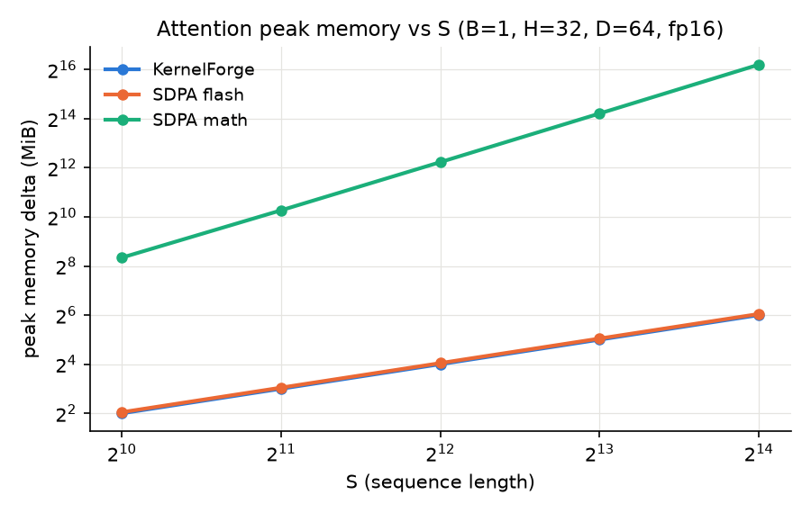

# KernelForge

[](https://github.com/Yaswanth2120/KernelForge/actions/workflows/ci.yml)

A small library of custom Triton GPU kernels: fused softmax, LayerNorm forward, and causal
attention forward. Each kernel has correctness tests and benchmarks against PyTorch, and the
performance report is generated against criteria pre-registered before any measurement. All
numbers come from an NVIDIA A100 80GB SXM4.

The measurement discipline is as much the deliverable as the kernels:

- the shapes and pass/fail criteria were frozen in [PREREG.md](PREREG.md) before any measurement;
- baselines are measured, not datasheet figures;
- byte and FLOP accounting is stated explicitly;
- every number is the median of three independent process launches, with GPU telemetry;
- the report is generated from committed raw JSON, with no hand-edited numbers.

## Results (A100-SXM4-80GB, torch 2.8.0, Triton 3.4.0, three independent launches)

| Pre-registered criterion | Cases | Result |
|---|---|---|
| 1. Correctness tests pass (CPU and GPU suites) | 228 CPU + 382 GPU | PASS (evidence under `reports/raw/k*_a100/`) |
| 2. Softmax effective bandwidth >= 0.80 x BW_copy (1757.9 GB/s) | 9 | 9/9 PASS (0.984-0.993) |
| 3. LayerNorm effective bandwidth >= 0.80 x BW_copy | 9 | 9/9 PASS (0.981-0.999) |
| 4. Causal attention TFLOPS >= 0.50 x SDPA-FlashAttention | 12 | 12/12 PASS (0.807-1.006) |
| 5. Numerical accuracy per the frozen tolerance rule | all tested cases | PASS |

BW_copy is the best of a Triton copy kernel and `Tensor.copy_` on a 1 GiB buffer. It measured
1757.9 GB/s, 0.862 of the 2,039 GB/s datasheet figure.

Selected attention cases (32 heads, causal, TFLOPS counting only the unmasked triangle):

| B x S | D | KernelForge fp16 / bf16 | SDPA-flash fp16 / bf16 | ratio |
|---|---|---|---|---|
| 8 x 2048 | 64 | 148.4 / 148.4 | 154.0 / 154.3 | 0.96 |
| 4 x 4096 | 64 | 161.3 / 163.4 | 162.1 / 165.2 | 0.99 |
| 2 x 8192 | 64 | 168.2 / 171.0 | 168.9 / 169.9 | 1.00 |
| 8 x 2048 | 128 | 141.5 / 142.4 | 173.2 / 176.4 | 0.81 |
| 4 x 4096 | 128 | 157.0 / 158.6 | 187.0 / 189.3 | 0.84 |
| 2 x 8192 | 128 | 164.3 / 167.1 | 192.7 / 197.7 | 0.85 |

| Softmax bandwidth | LayerNorm bandwidth | Attention peak memory vs S |
|---|---|---|
|  |  |  |

The full tables, accuracy, memory scaling, autotune choices, telemetry, and the "where we lose"
analysis are in the generated [performance report](reports/performance_report.md).

### Where KernelForge loses (measured; not pass/fail)

- **LayerNorm at N >= 65536:** 0.78-0.92x `F.layer_norm`. The looped path reads each row three
  times, a deliberate trade for accurate two-pass statistics.
- **LayerNorm at irregular widths** (1000, 4097, 31337): as low as 0.17x `F.layer_norm`. The
  cause is **not understood**. Row alignment was tested and ruled out
  ([profiling](docs/PROFILING.md)).
- **Attention at head dim 128:** 0.81-0.85x SDPA-FlashAttention on the selected shapes, and
  down to 0.77x in the full sweep.
- **Softmax at N >= 65536:** still faster than `torch.softmax`, but below 0.80 of BW_copy.

## The kernels

| Op | API | Design |
|---|---|---|
| Fused softmax | `softmax(x, dim=-1)` | Rows with N <= 65536 stay in registers in one program. Wider rows use a looped online-softmax kernel (running max and sum). fp32 accumulation, int64 offsets, `-inf` and NaN semantics match PyTorch. |
| LayerNorm forward | `layer_norm(x, normalized_shape, weight, bias, eps, return_stats)` | Rows with N <= 32768 use a single-block, two-pass centered variance. Wider rows use a three-pass looped kernel with per-lane fp64 sums. Supports mixed precision (fp32 affine with fp16/bf16 input) and optional per-row mean and rstd. |
| Causal attention forward | `causal_attention(q, k, v, sm_scale, return_lse)` | FlashAttention-2-style tiling with online softmax and `exp2` (log2(e) folded into the scale). Blocks above the diagonal are skipped, and masking is applied only to diagonal blocks. Arbitrary strides and S. The S x S matrix is never materialized, so memory grows O(S). |

All three are autotuned (`num_warps`, block sizes, `num_stages`), and out-of-resource
configurations are pruned rather than crashing. The math, ASCII tiling diagrams, numerical
choices, and citations (Triton tutorials, FlashAttention 1/2, Milakov & Gimelshein) are in
[docs/KERNELS.md](docs/KERNELS.md).

## Quickstart (CPU: tests, tooling, report generation)

Use Python 3.10-3.12. On macOS or Linux without a GPU:

```sh
git clone https://github.com/Yaswanth2120/KernelForge.git && cd KernelForge
python3.12 -m venv .venv
source .venv/bin/activate
python -m pip install -e '.[dev,report]'
pytest -m "not gpu and not slow"
ruff check .
kernelforge check-prereg
kernelforge report --raw reports/raw --out reports   # regenerate the report from committed JSON
```

`import kernelforge` works without Triton or CUDA. Calling an op there raises
`GPUUnavailableError`.

## GPU usage

On Linux with an NVIDIA sm_80+ GPU and the pinned PyTorch (Triton comes bundled with it):

```python
import torch
from kernelforge import causal_attention, layer_norm, softmax

x = torch.randn(4096, 8192, device="cuda", dtype=torch.bfloat16)
y = softmax(x)                                            # last dim only
z, mean, rstd = layer_norm(x, 8192, torch.ones(8192, device="cuda"), None, return_stats=True)
q, k, v = (torch.randn(2, 32, 4096, 128, device="cuda", dtype=torch.float16) for _ in range(3))
o = causal_attention(q, k, v)                             # (B, H, S, D), causal, no S x S matrix
```

Full GPU session (setup, tests, three-launch benchmarks, report, packaging):

```sh
bash scripts/gpu_session.sh setup
bash scripts/gpu_session.sh test -m 'gpu and not slow'
bash scripts/gpu_session.sh bench all
bash scripts/gpu_session.sh package
```

[docs/GPU_SESSION.md](docs/GPU_SESSION.md) explains each step and gives the run times
measured on the A100.

## CLI

```text
kernelforge doctor                         # GPU, torch/triton versions, ncu and interpreter probes
kernelforge test   [--gpu] [--op OP]       # CPU suite, or the non-slow GPU suite; OP in
                                           # softmax | layer_norm | causal_attention
kernelforge bench  --suite NAME --launches 3 --out reports/raw/
kernelforge copy-probe --out reports/raw/copy_probe.json
kernelforge report --raw reports/raw/ --out reports/
kernelforge check-prereg                   # asserts suites match PREREG.md
```

Exit codes: 0 ok; 1 test or criterion failure; 2 usage error; 3 environment check failed.

## Architecture

```text
 CPU-safe (imports without Triton/CUDA, runs in CI)      GPU-only (imports triton lazily)
 reference.py   fp32/fp64 PyTorch references             ops/softmax.py   + _softmax_kernels.py
 tolerance.py   error rule and floors                    ops/layernorm.py + _layernorm_kernels.py
 metrics.py     bytes, FLOPs, GB/s, TFLOPS        <-->   ops/attention.py + _attention_kernels.py
 bench/harness.py  injected timer, statistics            ops/_copy_kernels.py (BW_copy probe)
 bench/suites.py   shapes from PREREG                    bench/gpu_runner.py (do_bench timer,
 report.py      raw JSON -> Markdown and plots                nvidia-smi telemetry, 3 launches)
 env.py, cli.py
```

```text
src/kernelforge/     package (CPU-safe core; Triton kernels only under ops/)
tests/cpu/           228 tests: references, tolerance, metrics, harness, report, suites, interfaces
tests/gpu/           382 tests: dtype/shape/edge-case matrix, determinism, int64, SDPA agreement
scripts/             gpu_session.sh, threshold measurement, profiling, interpreter probe
reports/             performance_report.md, plots/, raw/ (every JSON and log behind the report)
docs/                KERNELS.md, PROFILING.md, GPU_SESSION.md, VALIDATION.md
```

## Documentation

- [PREREG.md](PREREG.md): frozen shapes, criteria, and timing protocol.
- [DECISIONS.md](DECISIONS.md): every ambiguous choice, every change, and every bug found on the GPU, dated.
- [docs/KERNELS.md](docs/KERNELS.md): per-kernel math, tiling diagrams, numerics, autotuning, and citations.
- [docs/PROFILING.md](docs/PROFILING.md): what could and could not be profiled, roofline-lite analysis, and the experiments.
- [docs/VALIDATION.md](docs/VALIDATION.md): CPU references, the tolerance rule, and accounting.
- [EXPLAINED.md](EXPLAINED.md): a plain-language explanation of every function.

## Status (v0.1.0)

- [x] CPU package, references, tolerance policy, accounting, harness, CLI, CI
- [x] Softmax: 130/130 GPU tests, threshold measured (65536), benchmark (criterion 2 pass)
- [x] LayerNorm: 168/168 GPU tests, threshold measured (32768), benchmark (criterion 3 pass)
- [x] Causal attention: 80/80 GPU tests, benchmark and memory scaling (criterion 4 pass)
- [x] Copy probe: 4/4 GPU tests, BW_copy measured
- [x] Profiling with fallbacks (ncu blocked: `ERR_NVGPUCTRPERM`)
- [x] Release tag `v0.1.0`

The benchmark git SHAs in the report (`e72400d`, `9852793`, `e85fdae`) are commits on the
milestone pull requests (#8-#10). `main` holds one squashed commit per milestone, and GitHub
keeps those commits reachable through the pull requests.

## Limitations

- **Hardware scope.** Every number is from one rented A100-SXM4-80GB with torch 2.8.0 and
  Triton 3.4.0. Autotuned choices and performance do not transfer to other GPUs or versions.
- **Power and clock variance.** Attention launches ran at the 400 W software power cap (throttle
  reason 0x4), so absolute TFLOPS are cap-limited; the report flags this. Spreads across the
  three launches are reported, not just medians.
- **Cache effects.** Bandwidth claims use inputs of at least 512 MiB (about 13x the L2 cache).
  Small shapes in the sweep may partly measure cache.
- **No hardware counters.** Nsight Compute was blocked in the container, so the profiling
  conclusions rest on traces, compile metadata, and controlled experiments.
- **Accounting.** Effective bandwidth uses the frozen byte formulas. The looped paths physically
  move more bytes than counted (softmax two reads, LayerNorm three).
- **Not implemented** (non-goals): backward passes, autograd or `torch.compile` integration,
  GQA/MQA, variable length, dropout, KV cache, multi-GPU, non-NVIDIA backends.
- **Process note.** The spec assumed the coding agent could not run a GPU. In practice, the
  GPU sessions ran over SSH on the owner's rented box. DECISIONS.md records this, along with
  every test fix and every post-hoc rule change, with original and changed values.
- **Effort.** The GPU spend is small. The cost is in iteration (edit, run, fail, fix) and in
  measurement.
