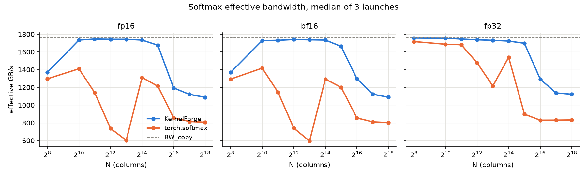
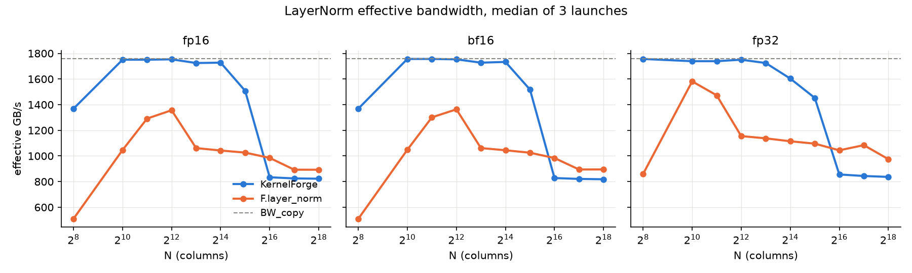
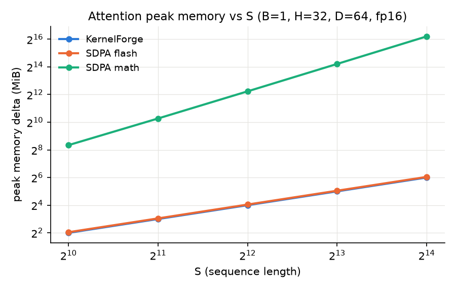

# Performance report

Generated by `kernelforge report` from `reports/raw/`; do not edit by hand.

## Environment

| device | cc | driver | CUDA | torch | triton | git SHA | date |
|---|---|---|---|---|---|---|---|
| NVIDIA A100-SXM4-80GB | 8.0 | 595.91.07 | 12.8 | 2.8.0+cu128 | 3.4.0 | e72400d | 2026-11-24 |
| NVIDIA A100-SXM4-80GB | 8.0 | 595.91.07 | 12.8 | 2.8.0+cu128 | 3.4.0 | 9852793 | 2026-11-24 |
| NVIDIA A100-SXM4-80GB | 8.0 | 595.91.07 | 12.8 | 2.8.0+cu128 | 3.4.0 | e85fdae | 2026-11-24 |

- `softmax`: run on an A100 (NVIDIA A100-SXM4-80GB).
- `layer_norm`: run on an A100 (NVIDIA A100-SXM4-80GB).
- `causal_attention`: run on an A100 (NVIDIA A100-SXM4-80GB).

## Pre-registered criterion 2: Softmax ratio >= 0.80

| N | dtype | M | GB/s | ratio to BW_copy | threshold | result | n |
|---|---|---|---|---|---|---|---|
| 2048 | fp16 | 131072 | 1744.7 | 0.993 | 0.80 | PASS | 3 |
| 2048 | bf16 | 131072 | 1730.3 | 0.984 | 0.80 | PASS | 3 |
| 2048 | fp32 | 65536 | 1744.7 | 0.993 | 0.80 | PASS | 3 |
| 4096 | fp16 | 65536 | 1741.8 | 0.991 | 0.80 | PASS | 3 |
| 4096 | bf16 | 65536 | 1738.9 | 0.989 | 0.80 | PASS | 3 |
| 4096 | fp32 | 32768 | 1736.1 | 0.988 | 0.80 | PASS | 3 |
| 8192 | fp16 | 32768 | 1741.8 | 0.991 | 0.80 | PASS | 3 |
| 8192 | bf16 | 32768 | 1736.1 | 0.988 | 0.80 | PASS | 3 |
| 8192 | fp32 | 16384 | 1730.3 | 0.984 | 0.80 | PASS | 3 |

## Pre-registered criterion 3: LayerNorm ratio >= 0.80

| N | dtype | M | GB/s | ratio to BW_copy | threshold | result | n |
|---|---|---|---|---|---|---|---|
| 2048 | fp16 | 131072 | 1750.6 | 0.996 | 0.80 | PASS | 3 |
| 2048 | bf16 | 131072 | 1756.4 | 0.999 | 0.80 | PASS | 3 |
| 2048 | fp32 | 65536 | 1739.0 | 0.989 | 0.80 | PASS | 3 |
| 4096 | fp16 | 65536 | 1753.5 | 0.998 | 0.80 | PASS | 3 |
| 4096 | bf16 | 65536 | 1753.5 | 0.998 | 0.80 | PASS | 3 |
| 4096 | fp32 | 32768 | 1750.6 | 0.996 | 0.80 | PASS | 3 |
| 8192 | fp16 | 32768 | 1724.7 | 0.981 | 0.80 | PASS | 3 |
| 8192 | bf16 | 32768 | 1727.5 | 0.983 | 0.80 | PASS | 3 |
| 8192 | fp32 | 16384 | 1724.7 | 0.981 | 0.80 | PASS | 3 |

## Pre-registered criterion 4: attention TFLOPS >= 0.50 x SDPA-FlashAttention

| B x H x S x D | dtype | KernelForge TFLOPS | SDPA-flash TFLOPS | ratio | threshold | result | n |
|---|---|---|---|---|---|---|---|
| 8x32x2048x64 | fp16 | 148.4 | 154.0 | 0.964 | 0.50 | PASS | 3 |
| 8x32x2048x64 | bf16 | 148.4 | 154.3 | 0.961 | 0.50 | PASS | 3 |
| 8x32x2048x128 | fp16 | 141.5 | 173.2 | 0.817 | 0.50 | PASS | 3 |
| 8x32x2048x128 | bf16 | 142.4 | 176.4 | 0.807 | 0.50 | PASS | 3 |
| 4x32x4096x64 | fp16 | 161.3 | 162.1 | 0.995 | 0.50 | PASS | 3 |
| 4x32x4096x64 | bf16 | 163.4 | 165.2 | 0.989 | 0.50 | PASS | 3 |
| 4x32x4096x128 | fp16 | 157.0 | 187.0 | 0.840 | 0.50 | PASS | 3 |
| 4x32x4096x128 | bf16 | 158.6 | 189.3 | 0.838 | 0.50 | PASS | 3 |
| 2x32x8192x64 | fp16 | 168.2 | 168.9 | 0.996 | 0.50 | PASS | 3 |
| 2x32x8192x64 | bf16 | 171.0 | 169.9 | 1.006 | 0.50 | PASS | 3 |
| 2x32x8192x128 | fp16 | 164.3 | 192.7 | 0.853 | 0.50 | PASS | 3 |
| 2x32x8192x128 | bf16 | 167.1 | 197.7 | 0.845 | 0.50 | PASS | 3 |

## Memory-copy baseline (BW_copy)

| implementation | call | GB/s | ms p50 (launch range) | n |
|---|---|---|---|---|
| triton_copy | `kernelforge.ops._copy_kernels.triton_copy(x, y)` | 1757.9 | 1.2216 (1.2216-1.2237) | 3 |
| torch_copy_ | `y.copy_(x)` | 1746.2 | 1.2298 (1.2298-1.2298) | 3 |

BW_copy = **1757.9 GB/s** (triton_copy), 0.862 of the 2039 GB/s datasheet figure. Buffer: 1073741824 bytes, counted as one read plus one write.

## Softmax sweep

Effective bandwidth = 2*M*N*elem_size, divided by the median time (median of three launch medians; launch range in parentheses). Selected cases are marked *. Baseline call: `torch.softmax(x, dim=-1)`.

| N | dtype | M | KernelForge GB/s | ms p50 (range) | torch.softmax GB/s | KF/torch | KF ratio to BW_copy | n |
|---|---|---|---|---|---|---|---|---|
| 256 | fp16 | 1048576 | 1368.9 | 0.7844 (0.7844-0.7844) | 1296.1 | 1.056 | 0.779 | 3 |
| 256 | bf16 | 1048576 | 1368.9 | 0.7844 (0.7834-0.7844) | 1292.9 | 1.059 | 0.779 | 3 |
| 256 | fp32 | 524288 | 1756.4 | 0.6113 (0.6113-0.6124) | 1716.2 | 1.023 | 0.999 | 3 |
| 1024 | fp16 | 262144 | 1733.2 | 0.6195 (0.6185-0.6195) | 1409.4 | 1.230 | 0.986 | 3 |
| 1024 | bf16 | 262144 | 1727.5 | 0.6216 (0.6216-0.6246) | 1417.0 | 1.219 | 0.983 | 3 |
| 1024 | fp32 | 131072 | 1753.5 | 0.6124 (0.6103-0.6124) | 1685.8 | 1.040 | 0.997 | 3 |
| 2048* | fp16 | 131072 | 1744.7 | 0.6154 (0.6154-0.6175) | 1141.0 | 1.529 | 0.993 | 3 |
| 2048* | bf16 | 131072 | 1730.3 | 0.6205 (0.6195-0.6226) | 1146.0 | 1.510 | 0.984 | 3 |
| 2048* | fp32 | 65536 | 1744.7 | 0.6154 (0.6154-0.6175) | 1680.4 | 1.038 | 0.993 | 3 |
| 4096* | fp16 | 65536 | 1741.8 | 0.6164 (0.6154-0.6175) | 737.9 | 2.360 | 0.991 | 3 |
| 4096* | bf16 | 65536 | 1738.9 | 0.6175 (0.6175-0.6211) | 740.5 | 2.348 | 0.989 | 3 |
| 4096* | fp32 | 32768 | 1736.1 | 0.6185 (0.6164-0.6195) | 1476.9 | 1.175 | 0.988 | 3 |
| 8192* | fp16 | 32768 | 1741.8 | 0.6164 (0.6164-0.6195) | 603.0 | 2.889 | 0.991 | 3 |
| 8192* | bf16 | 32768 | 1736.1 | 0.6185 (0.6185-0.6185) | 594.8 | 2.919 | 0.988 | 3 |
| 8192* | fp32 | 16384 | 1730.3 | 0.6205 (0.6195-0.6236) | 1215.0 | 1.424 | 0.984 | 3 |
| 16384 | fp16 | 16384 | 1733.2 | 0.6195 (0.6185-0.6236) | 1310.7 | 1.322 | 0.986 | 3 |
| 16384 | bf16 | 16384 | 1733.2 | 0.6195 (0.6195-0.6195) | 1292.9 | 1.340 | 0.986 | 3 |
| 16384 | fp32 | 8192 | 1721.8 | 0.6236 (0.6236-0.6246) | 1539.8 | 1.118 | 0.979 | 3 |
| 32768 | fp16 | 8192 | 1675.0 | 0.6410 (0.6410-0.6492) | 1213.6 | 1.380 | 0.953 | 3 |
| 32768 | bf16 | 8192 | 1661.8 | 0.6461 (0.6461-0.6472) | 1201.1 | 1.384 | 0.945 | 3 |
| 32768 | fp32 | 4096 | 1696.7 | 0.6328 (0.6328-0.6339) | 897.8 | 1.890 | 0.965 | 3 |
| 65536 | fp16 | 4096 | 1194.3 | 0.8991 (0.8991-0.9206) | 858.1 | 1.392 | 0.679 | 3 |
| 65536 | bf16 | 4096 | 1297.7 | 0.8274 (0.8264-0.8320) | 855.3 | 1.517 | 0.738 | 3 |
| 65536 | fp32 | 2048 | 1292.9 | 0.8305 (0.8294-0.8335) | 830.2 | 1.557 | 0.736 | 3 |
| 131072 | fp16 | 2048 | 1121.5 | 0.9574 (0.9574-0.9595) | 815.4 | 1.375 | 0.638 | 3 |
| 131072 | bf16 | 2048 | 1122.7 | 0.9564 (0.9564-0.9585) | 811.6 | 1.383 | 0.639 | 3 |
| 131072 | fp32 | 1024 | 1137.3 | 0.9441 (0.9431-0.9523) | 830.9 | 1.369 | 0.647 | 3 |
| 262144 | fp16 | 1024 | 1087.7 | 0.9871 (0.9871-0.9907) | 806.9 | 1.348 | 0.619 | 3 |
| 262144 | bf16 | 1024 | 1088.9 | 0.9861 (0.9861-0.9871) | 802.9 | 1.356 | 0.619 | 3 |
| 262144 | fp32 | 512 | 1122.7 | 0.9564 (0.9564-0.9605) | 832.9 | 1.348 | 0.639 | 3 |
| 1000 | fp16 | 268436 | 1713.4 | 0.6267 (0.6257-0.6267) | 1372.5 | 1.248 | 0.975 | 3 |
| 1000 | bf16 | 268436 | 1713.4 | 0.6267 (0.6257-0.6267) | 1377.9 | 1.243 | 0.975 | 3 |
| 1000 | fp32 | 134218 | 1736.1 | 0.6185 (0.6185-0.6195) | 1691.3 | 1.026 | 0.988 | 3 |
| 4097 | fp16 | 65521 | 1648.7 | 0.6513 (0.6513-0.6523) | 686.7 | 2.401 | 0.938 | 3 |
| 4097 | bf16 | 65521 | 1648.7 | 0.6513 (0.6513-0.6543) | 688.1 | 2.396 | 0.938 | 3 |
| 4097 | fp32 | 32761 | 1702.3 | 0.6308 (0.6298-0.6308) | 1379.7 | 1.234 | 0.968 | 3 |
| 31337 | fp16 | 8567 | 1428.7 | 0.7516 (0.7516-0.7547) | 993.1 | 1.439 | 0.813 | 3 |
| 31337 | bf16 | 8567 | 1444.5 | 0.7434 (0.7434-0.7434) | 984.7 | 1.467 | 0.822 | 3 |
| 31337 | fp32 | 4284 | 1544.6 | 0.6953 (0.6953-0.6973) | 968.4 | 1.595 | 0.879 | 3 |



## Accuracy (Softmax, benchmark inputs)

| N | dtype | KernelForge max abs err | torch max abs err | allowed | result |
|---|---|---|---|---|---|
| 256 | fp16 | 1.417e-04 | 1.417e-04 | 1.054e-03 | PASS |
| 256 | bf16 | 1.324e-03 | 1.324e-03 | 8.383e-03 | PASS |
| 256 | fp32 | 5.960e-08 | 5.960e-08 | 1.286e-07 | PASS |
| 1024 | fp16 | 4.539e-05 | 4.539e-05 | 3.126e-04 | PASS |
| 1024 | bf16 | 4.627e-04 | 4.627e-04 | 2.501e-03 | PASS |
| 1024 | fp32 | 1.490e-08 | 1.490e-08 | 3.382e-08 | PASS |
| 2048 | fp16 | 2.870e-05 | 2.870e-05 | 1.679e-04 | PASS |
| 2048 | bf16 | 2.377e-04 | 2.377e-04 | 1.339e-03 | PASS |
| 2048 | fp32 | 7.451e-09 | 7.451e-09 | 2.049e-08 | PASS |
| 4096 | fp16 | 1.496e-05 | 1.496e-05 | 8.178e-05 | PASS |
| 4096 | bf16 | 1.153e-04 | 1.153e-04 | 6.493e-04 | PASS |
| 4096 | fp32 | 3.725e-09 | 3.725e-09 | 1.000e-08 | PASS |
| 8192 | fp16 | 6.570e-06 | 6.570e-06 | 3.814e-05 | PASS |
| 8192 | bf16 | 6.042e-05 | 6.042e-05 | 3.075e-04 | PASS |
| 8192 | fp32 | 1.863e-09 | 1.863e-09 | 4.654e-09 | PASS |
| 16384 | fp16 | 3.676e-06 | 3.676e-06 | 2.267e-05 | PASS |
| 16384 | bf16 | 2.643e-05 | 2.643e-05 | 1.800e-04 | PASS |
| 16384 | fp32 | 9.313e-10 | 9.313e-10 | 2.330e-09 | PASS |
| 32768 | fp16 | 1.639e-06 | 1.639e-06 | 1.705e-05 | PASS |
| 32768 | bf16 | 2.171e-05 | 2.171e-05 | 1.348e-04 | PASS |
| 32768 | fp32 | 9.313e-10 | 4.657e-10 | 1.367e-09 | PASS |
| 65536 | fp16 | 8.580e-07 | 8.580e-07 | 6.621e-06 | PASS |
| 65536 | bf16 | 6.843e-06 | 6.843e-06 | 5.317e-05 | PASS |
| 65536 | fp32 | 4.657e-10 | 4.657e-10 | 9.313e-10 | PASS |
| 131072 | fp16 | 4.458e-07 | 4.458e-07 | 3.521e-06 | PASS |
| 131072 | bf16 | 3.391e-06 | 3.391e-06 | 2.806e-05 | PASS |
| 131072 | fp32 | 2.328e-10 | 1.746e-10 | 4.294e-10 | PASS |
| 262144 | fp16 | 2.369e-07 | 2.369e-07 | 1.683e-06 | PASS |
| 262144 | bf16 | 1.863e-06 | 1.863e-06 | 1.331e-05 | PASS |
| 262144 | fp32 | 1.164e-10 | 5.821e-11 | 2.059e-10 | PASS |
| 1000 | fp16 | 4.077e-05 | 4.077e-05 | 4.198e-04 | PASS |
| 1000 | bf16 | 3.155e-04 | 3.155e-04 | 3.390e-03 | PASS |
| 1000 | fp32 | 1.490e-08 | 2.980e-08 | 5.960e-08 | PASS |
| 4097 | fp16 | 1.398e-05 | 1.398e-05 | 1.095e-04 | PASS |
| 4097 | bf16 | 1.032e-04 | 1.032e-04 | 8.824e-04 | PASS |
| 4097 | fp32 | 5.588e-09 | 3.725e-09 | 1.339e-08 | PASS |
| 31337 | fp16 | 1.882e-06 | 1.882e-06 | 1.409e-05 | PASS |
| 31337 | bf16 | 1.522e-05 | 1.522e-05 | 1.123e-04 | PASS |
| 31337 | fp32 | 9.313e-10 | 6.985e-10 | 1.448e-09 | PASS |

## Peak memory (Softmax)

Delta of `max_memory_allocated()` over the allocated inputs for one call; the output tensor is included.

| N | dtype | input bytes | KernelForge delta | torch delta |
|---|---|---|---|---|
| 256 | fp16 | 536870912 | 536870912 | 536870912 |
| 256 | bf16 | 536870912 | 536870912 | 536870912 |
| 256 | fp32 | 536870912 | 536870912 | 536870912 |
| 1024 | fp16 | 536870912 | 536870912 | 536870912 |
| 1024 | bf16 | 536870912 | 536870912 | 536870912 |
| 1024 | fp32 | 536870912 | 536870912 | 536870912 |
| 2048 | fp16 | 536870912 | 536870912 | 536870912 |
| 2048 | bf16 | 536870912 | 536870912 | 536870912 |
| 2048 | fp32 | 536870912 | 536870912 | 536870912 |
| 4096 | fp16 | 536870912 | 536870912 | 536870912 |
| 4096 | bf16 | 536870912 | 536870912 | 536870912 |
| 4096 | fp32 | 536870912 | 536870912 | 536870912 |
| 8192 | fp16 | 536870912 | 536870912 | 536870912 |
| 8192 | bf16 | 536870912 | 536870912 | 536870912 |
| 8192 | fp32 | 536870912 | 536870912 | 536870912 |
| 16384 | fp16 | 536870912 | 536870912 | 536870912 |
| 16384 | bf16 | 536870912 | 536870912 | 536870912 |
| 16384 | fp32 | 536870912 | 536870912 | 536870912 |
| 32768 | fp16 | 536870912 | 536870912 | 536870912 |
| 32768 | bf16 | 536870912 | 536870912 | 536870912 |
| 32768 | fp32 | 536870912 | 536870912 | 536870912 |
| 65536 | fp16 | 536870912 | 536870912 | 536870912 |
| 65536 | bf16 | 536870912 | 536870912 | 536870912 |
| 65536 | fp32 | 536870912 | 536870912 | 536870912 |
| 131072 | fp16 | 536870912 | 536870912 | 536870912 |
| 131072 | bf16 | 536870912 | 536870912 | 536870912 |
| 131072 | fp32 | 536870912 | 536870912 | 536870912 |
| 262144 | fp16 | 536870912 | 536870912 | 536870912 |
| 262144 | bf16 | 536870912 | 536870912 | 536870912 |
| 262144 | fp32 | 536870912 | 536870912 | 536870912 |
| 1000 | fp16 | 536872000 | 536872448 | 536872448 |
| 1000 | bf16 | 536872000 | 536872448 | 536872448 |
| 1000 | fp32 | 536872000 | 536872448 | 536872448 |
| 4097 | fp16 | 536879074 | 536879104 | 536879104 |
| 4097 | bf16 | 536879074 | 536879104 | 536879104 |
| 4097 | fp32 | 536887268 | 536887296 | 536887296 |
| 31337 | fp16 | 536928158 | 536928256 | 536928256 |
| 31337 | bf16 | 536928158 | 536928256 | 536928256 |
| 31337 | fp32 | 536990832 | 536991232 | 536991232 |

## Autotune (Softmax)

First-call seconds include compilation and autotuning and are excluded from timing.

| N | dtype | winner (launch 0) | same winner in all launches | rejected configs | first-call s (max) |
|---|---|---|---|---|---|
| 256 | fp16 | `{"block": 256, "num_warps": 2, "num_stages": 1}` | no | {"pruned": 1} | 1.2 |
| 256 | bf16 | `{"block": 256, "num_warps": 1, "num_stages": 1}` | no | {"pruned": 1} | 0.9 |
| 256 | fp32 | `{"block": 256, "num_warps": 2, "num_stages": 1}` | yes | {"pruned": 1} | 0.9 |
| 1024 | fp16 | `{"block": 1024, "num_warps": 4, "num_stages": 1}` | yes | none | 0.6 |
| 1024 | bf16 | `{"block": 1024, "num_warps": 4, "num_stages": 1}` | no | none | 0.6 |
| 1024 | fp32 | `{"block": 1024, "num_warps": 8, "num_stages": 1}` | yes | none | 0.6 |
| 2048 | fp16 | `{"block": 2048, "num_warps": 2, "num_stages": 1}` | yes | none | 0.6 |
| 2048 | bf16 | `{"block": 2048, "num_warps": 4, "num_stages": 1}` | no | none | 0.6 |
| 2048 | fp32 | `{"block": 2048, "num_warps": 16, "num_stages": 1}` | yes | none | 0.6 |
| 4096 | fp16 | `{"block": 4096, "num_warps": 4, "num_stages": 1}` | yes | none | 0.6 |
| 4096 | bf16 | `{"block": 4096, "num_warps": 4, "num_stages": 1}` | no | none | 0.6 |
| 4096 | fp32 | `{"block": 4096, "num_warps": 16, "num_stages": 1}` | no | none | 0.6 |
| 8192 | fp16 | `{"block": 8192, "num_warps": 8, "num_stages": 1}` | yes | none | 0.6 |
| 8192 | bf16 | `{"block": 8192, "num_warps": 4, "num_stages": 1}` | yes | none | 0.6 |
| 8192 | fp32 | `{"block": 8192, "num_warps": 16, "num_stages": 1}` | yes | none | 0.6 |
| 16384 | fp16 | `{"block": 16384, "num_warps": 16, "num_stages": 1}` | yes | none | 0.7 |
| 16384 | bf16 | `{"block": 16384, "num_warps": 16, "num_stages": 1}` | yes | none | 0.7 |
| 16384 | fp32 | `{"block": 16384, "num_warps": 16, "num_stages": 1}` | no | none | 0.7 |
| 32768 | fp16 | `{"block": 32768, "num_warps": 16, "num_stages": 1}` | yes | none | 0.7 |
| 32768 | bf16 | `{"block": 32768, "num_warps": 16, "num_stages": 1}` | yes | none | 0.9 |
| 32768 | fp32 | `{"block": 32768, "num_warps": 16, "num_stages": 1}` | yes | none | 0.7 |
| 65536 | fp16 | `{"block": 65536, "num_warps": 8, "num_stages": 1}` | yes | none | 0.8 |
| 65536 | bf16 | `{"block": 65536, "num_warps": 8, "num_stages": 1}` | yes | none | 0.8 |
| 65536 | fp32 | `{"block": 65536, "num_warps": 8, "num_stages": 1}` | yes | none | 0.7 |
| 131072 | fp16 | `{"block": 4096, "num_warps": 8, "num_stages": 1}` | yes | none | 4.3 |
| 131072 | bf16 | `{"block": 4096, "num_warps": 8, "num_stages": 1}` | yes | none | 4.3 |
| 131072 | fp32 | `{"block": 4096, "num_warps": 2, "num_stages": 1}` | yes | none | 4.3 |
| 262144 | fp16 | `{"block": 2048, "num_warps": 2, "num_stages": 1}` | yes | none | 4.3 |
| 262144 | bf16 | `{"block": 4096, "num_warps": 8, "num_stages": 1}` | no | none | 4.3 |
| 262144 | fp32 | `{"block": 4096, "num_warps": 8, "num_stages": 1}` | no | none | 4.3 |
| 1000 | fp16 | `{"block": 1024, "num_warps": 2, "num_stages": 1}` | yes | none | 1.1 |
| 1000 | bf16 | `{"block": 1024, "num_warps": 2, "num_stages": 1}` | yes | none | 1.1 |
| 1000 | fp32 | `{"block": 1024, "num_warps": 8, "num_stages": 1}` | no | none | 1.1 |
| 4097 | fp16 | `{"block": 8192, "num_warps": 2, "num_stages": 1}` | yes | none | 0.6 |
| 4097 | bf16 | `{"block": 8192, "num_warps": 4, "num_stages": 1}` | no | none | 0.7 |
| 4097 | fp32 | `{"block": 8192, "num_warps": 16, "num_stages": 1}` | yes | none | 0.6 |
| 31337 | fp16 | `{"block": 32768, "num_warps": 4, "num_stages": 1}` | yes | none | 20.2 |
| 31337 | bf16 | `{"block": 32768, "num_warps": 4, "num_stages": 1}` | yes | none | 20.2 |
| 31337 | fp32 | `{"block": 32768, "num_warps": 4, "num_stages": 1}` | yes | none | 15.1 |

## LayerNorm sweep

Effective bandwidth = 2*M*N*elem_size + N*(weight_elem + bias_elem); weight and bias use the input dtype; stats are not returned, divided by the median time (median of three launch medians; launch range in parentheses). Selected cases are marked *. Baseline call: `F.layer_norm(x, (N,), weight, bias)`.

| N | dtype | M | KernelForge GB/s | ms p50 (range) | F.layer_norm GB/s | KF/torch | KF ratio to BW_copy | n |
|---|---|---|---|---|---|---|---|---|
| 256 | fp16 | 1048576 | 1368.9 | 0.7844 (0.7844-0.7844) | 510.3 | 2.683 | 0.779 | 3 |
| 256 | bf16 | 1048576 | 1368.9 | 0.7844 (0.7834-0.7844) | 510.0 | 2.684 | 0.779 | 3 |
| 256 | fp32 | 524288 | 1756.4 | 0.6113 (0.6113-0.6195) | 860.2 | 2.042 | 0.999 | 3 |
| 1024 | fp16 | 262144 | 1750.6 | 0.6134 (0.6134-0.6154) | 1046.5 | 1.673 | 0.996 | 3 |
| 1024 | bf16 | 262144 | 1756.4 | 0.6113 (0.6113-0.6124) | 1048.6 | 1.675 | 0.999 | 3 |
| 1024 | fp32 | 131072 | 1738.9 | 0.6175 (0.6164-0.6195) | 1581.6 | 1.100 | 0.989 | 3 |
| 2048* | fp16 | 131072 | 1750.6 | 0.6134 (0.6124-0.6154) | 1291.4 | 1.356 | 0.996 | 3 |
| 2048* | bf16 | 131072 | 1756.4 | 0.6113 (0.6113-0.6113) | 1301.0 | 1.350 | 0.999 | 3 |
| 2048* | fp32 | 65536 | 1739.0 | 0.6175 (0.6175-0.6175) | 1472.7 | 1.181 | 0.989 | 3 |
| 4096* | fp16 | 65536 | 1753.5 | 0.6124 (0.6124-0.6134) | 1356.5 | 1.293 | 0.998 | 3 |
| 4096* | bf16 | 65536 | 1753.5 | 0.6124 (0.6124-0.6124) | 1363.6 | 1.286 | 0.998 | 3 |
| 4096* | fp32 | 32768 | 1750.6 | 0.6134 (0.6134-0.6144) | 1154.9 | 1.516 | 0.996 | 3 |
| 8192* | fp16 | 32768 | 1724.7 | 0.6226 (0.6216-0.6246) | 1061.3 | 1.625 | 0.981 | 3 |
| 8192* | bf16 | 32768 | 1727.5 | 0.6216 (0.6205-0.6216) | 1061.3 | 1.628 | 0.983 | 3 |
| 8192* | fp32 | 16384 | 1724.7 | 0.6226 (0.6226-0.6226) | 1137.4 | 1.516 | 0.981 | 3 |
| 16384 | fp16 | 16384 | 1727.6 | 0.6216 (0.6205-0.6226) | 1042.4 | 1.657 | 0.983 | 3 |
| 16384 | bf16 | 16384 | 1733.3 | 0.6195 (0.6195-0.6205) | 1044.5 | 1.660 | 0.986 | 3 |
| 16384 | fp32 | 8192 | 1603.5 | 0.6697 (0.6687-0.6758) | 1114.5 | 1.439 | 0.912 | 3 |
| 32768 | fp16 | 8192 | 1507.8 | 0.7122 (0.7117-0.7127) | 1026.1 | 1.469 | 0.858 | 3 |
| 32768 | bf16 | 8192 | 1517.7 | 0.7076 (0.7066-0.7096) | 1025.1 | 1.480 | 0.863 | 3 |
| 32768 | fp32 | 4096 | 1452.7 | 0.7393 (0.7393-0.7414) | 1096.0 | 1.325 | 0.826 | 3 |
| 65536 | fp16 | 4096 | 833.7 | 1.2882 (1.2882-1.2882) | 984.8 | 0.847 | 0.474 | 3 |
| 65536 | bf16 | 4096 | 827.8 | 1.2974 (1.2943-1.2974) | 983.9 | 0.841 | 0.471 | 3 |
| 65536 | fp32 | 2048 | 855.7 | 1.2554 (1.2554-1.2564) | 1043.9 | 0.820 | 0.487 | 3 |
| 131072 | fp16 | 2048 | 824.8 | 1.3025 (1.3015-1.3036) | 892.8 | 0.924 | 0.469 | 3 |
| 131072 | bf16 | 2048 | 820.9 | 1.3087 (1.3066-1.3087) | 894.4 | 0.918 | 0.467 | 3 |
| 131072 | fp32 | 1024 | 843.7 | 1.2739 (1.2728-1.2749) | 1084.3 | 0.778 | 0.480 | 3 |
| 262144 | fp16 | 1024 | 822.6 | 1.3066 (1.3056-1.3087) | 892.5 | 0.922 | 0.468 | 3 |
| 262144 | bf16 | 1024 | 818.1 | 1.3138 (1.3117-1.3138) | 894.8 | 0.914 | 0.465 | 3 |
| 262144 | fp32 | 512 | 836.5 | 1.2861 (1.2861-1.2872) | 975.1 | 0.858 | 0.476 | 3 |
| 1000 | fp16 | 268436 | 995.8 | 1.0783 (1.0747-1.0783) | 1024.0 | 0.972 | 0.566 | 3 |
| 1000 | bf16 | 268436 | 1003.4 | 1.0701 (1.0701-1.0701) | 1022.0 | 0.982 | 0.571 | 3 |
| 1000 | fp32 | 134218 | 1677.7 | 0.6400 (0.6390-0.6400) | 1517.5 | 1.106 | 0.954 | 3 |
| 4097 | fp16 | 65521 | 513.3 | 2.0920 (2.0920-2.0920) | 477.7 | 1.074 | 0.292 | 3 |
| 4097 | bf16 | 65521 | 508.2 | 2.1130 (2.1100-2.1135) | 474.1 | 1.072 | 0.289 | 3 |
| 4097 | fp32 | 32761 | 1050.7 | 1.0220 (1.0209-1.0220) | 765.4 | 1.373 | 0.598 | 3 |
| 31337 | fp16 | 8567 | 285.4 | 3.7632 (3.7632-3.7755) | 535.1 | 0.533 | 0.162 | 3 |
| 31337 | bf16 | 8567 | 88.7 | 12.1042 (12.0934-12.1057) | 533.7 | 0.166 | 0.050 | 3 |
| 31337 | fp32 | 4284 | 181.9 | 5.9064 (5.9059-5.9177) | 780.0 | 0.233 | 0.103 | 3 |



## Accuracy (LayerNorm, benchmark inputs)

| N | dtype | KernelForge max abs err | torch max abs err | allowed | result |
|---|---|---|---|---|---|
| 256 | fp16 | 3.907e-03 | 3.907e-03 | 2.768e-02 | PASS |
| 256 | bf16 | 3.124e-02 | 3.124e-02 | 2.206e-01 | PASS |
| 256 | fp32 | 2.861e-06 | 1.907e-06 | 3.815e-06 | PASS |
| 1024 | fp16 | 3.907e-03 | 3.907e-03 | 3.026e-02 | PASS |
| 1024 | bf16 | 3.125e-02 | 3.125e-02 | 2.427e-01 | PASS |
| 1024 | fp32 | 2.861e-06 | 2.861e-06 | 5.722e-06 | PASS |
| 2048 | fp16 | 6.950e-03 | 6.950e-03 | 3.644e-02 | PASS |
| 2048 | bf16 | 5.757e-02 | 5.757e-02 | 2.902e-01 | PASS |
| 2048 | fp32 | 2.861e-06 | 2.861e-06 | 5.722e-06 | PASS |
| 4096 | fp16 | 7.215e-03 | 7.215e-03 | 3.586e-02 | PASS |
| 4096 | bf16 | 6.151e-02 | 6.151e-02 | 2.872e-01 | PASS |
| 4096 | fp32 | 2.861e-06 | 2.861e-06 | 5.722e-06 | PASS |
| 8192 | fp16 | 7.730e-03 | 7.730e-03 | 3.796e-02 | PASS |
| 8192 | bf16 | 5.275e-02 | 5.275e-02 | 3.041e-01 | PASS |
| 8192 | fp32 | 2.861e-06 | 2.861e-06 | 5.722e-06 | PASS |
| 16384 | fp16 | 7.635e-03 | 7.635e-03 | 3.383e-02 | PASS |
| 16384 | bf16 | 3.670e-02 | 3.670e-02 | 2.709e-01 | PASS |
| 16384 | fp32 | 2.861e-06 | 2.861e-06 | 5.722e-06 | PASS |
| 32768 | fp16 | 7.227e-03 | 7.227e-03 | 3.473e-02 | PASS |
| 32768 | bf16 | 5.298e-02 | 5.298e-02 | 2.785e-01 | PASS |
| 32768 | fp32 | 2.861e-06 | 2.861e-06 | 5.722e-06 | PASS |
| 65536 | fp16 | 7.637e-03 | 7.637e-03 | 3.319e-02 | PASS |
| 65536 | bf16 | 5.571e-02 | 5.571e-02 | 2.653e-01 | PASS |
| 65536 | fp32 | 3.815e-06 | 3.815e-06 | 7.629e-06 | PASS |
| 131072 | fp16 | 6.496e-03 | 6.496e-03 | 3.556e-02 | PASS |
| 131072 | bf16 | 6.169e-02 | 6.169e-02 | 2.847e-01 | PASS |
| 131072 | fp32 | 2.861e-06 | 2.861e-06 | 5.722e-06 | PASS |
| 262144 | fp16 | 4.822e-03 | 4.822e-03 | 3.565e-02 | PASS |
| 262144 | bf16 | 4.342e-02 | 4.342e-02 | 2.857e-01 | PASS |
| 262144 | fp32 | 2.861e-06 | 2.861e-06 | 5.722e-06 | PASS |
| 1000 | fp16 | 3.908e-03 | 3.906e-03 | 3.177e-02 | PASS |
| 1000 | bf16 | 5.093e-02 | 5.093e-02 | 2.544e-01 | PASS |
| 1000 | fp32 | 3.815e-06 | 3.815e-06 | 7.629e-06 | PASS |
| 4097 | fp16 | 7.729e-03 | 7.729e-03 | 3.536e-02 | PASS |
| 4097 | bf16 | 6.177e-02 | 6.177e-02 | 2.820e-01 | PASS |
| 4097 | fp32 | 2.861e-06 | 2.861e-06 | 5.722e-06 | PASS |
| 31337 | fp16 | 6.729e-03 | 6.729e-03 | 3.253e-02 | PASS |
| 31337 | bf16 | 6.005e-02 | 6.005e-02 | 2.611e-01 | PASS |
| 31337 | fp32 | 4.768e-06 | 2.861e-06 | 5.722e-06 | PASS |

## Peak memory (LayerNorm)

Delta of `max_memory_allocated()` over the allocated inputs for one call; the output tensor is included.

| N | dtype | input bytes | KernelForge delta | torch delta |
|---|---|---|---|---|
| 256 | fp16 | 536870912 | 536870912 | 545259520 |
| 256 | bf16 | 536870912 | 536870912 | 545259520 |
| 256 | fp32 | 536870912 | 536870912 | 541065216 |
| 1024 | fp16 | 536870912 | 536870912 | 538968064 |
| 1024 | bf16 | 536870912 | 536870912 | 538968064 |
| 1024 | fp32 | 536870912 | 536870912 | 537919488 |
| 2048 | fp16 | 536870912 | 536870912 | 537919488 |
| 2048 | bf16 | 536870912 | 536870912 | 537919488 |
| 2048 | fp32 | 536870912 | 536870912 | 537395200 |
| 4096 | fp16 | 536870912 | 536870912 | 537395200 |
| 4096 | bf16 | 536870912 | 536870912 | 537395200 |
| 4096 | fp32 | 536870912 | 536870912 | 537133056 |
| 8192 | fp16 | 536870912 | 536870912 | 537133056 |
| 8192 | bf16 | 536870912 | 536870912 | 537133056 |
| 8192 | fp32 | 536870912 | 536870912 | 537001984 |
| 16384 | fp16 | 536870912 | 536870912 | 537001984 |
| 16384 | bf16 | 536870912 | 536870912 | 537001984 |
| 16384 | fp32 | 536870912 | 536870912 | 536936448 |
| 32768 | fp16 | 536870912 | 536870912 | 536936448 |
| 32768 | bf16 | 536870912 | 536870912 | 536936448 |
| 32768 | fp32 | 536870912 | 536870912 | 536903680 |
| 65536 | fp16 | 536870912 | 536870912 | 536903680 |
| 65536 | bf16 | 536870912 | 536870912 | 536903680 |
| 65536 | fp32 | 536870912 | 536870912 | 536887296 |
| 131072 | fp16 | 536870912 | 536870912 | 536887296 |
| 131072 | bf16 | 536870912 | 536870912 | 536887296 |
| 131072 | fp32 | 536870912 | 536870912 | 536879104 |
| 262144 | fp16 | 536870912 | 536870912 | 536879104 |
| 262144 | bf16 | 536870912 | 536870912 | 536879104 |
| 262144 | fp32 | 536870912 | 536870912 | 536875008 |
| 1000 | fp16 | 536872000 | 536872448 | 541063680 |
| 1000 | bf16 | 536872000 | 536872448 | 541063680 |
| 1000 | fp32 | 536872000 | 536872448 | 537946624 |
| 4097 | fp16 | 536879074 | 536879104 | 537403392 |
| 4097 | bf16 | 536879074 | 536879104 | 537403392 |
| 4097 | fp32 | 536887268 | 536887296 | 537149440 |
| 31337 | fp16 | 536928158 | 536928256 | 536996864 |
| 31337 | bf16 | 536928158 | 536928256 | 536996864 |
| 31337 | fp32 | 536990832 | 536991232 | 537026048 |

## Autotune (LayerNorm)

First-call seconds include compilation and autotuning and are excluded from timing.

| N | dtype | winner (launch 0) | same winner in all launches | rejected configs | first-call s (max) |
|---|---|---|---|---|---|
| 256 | fp16 | `{"path": "single", "block": 256, "num_warps": 1, "num_stages": 3}` | yes | none | 1.3 |
| 256 | bf16 | `{"path": "single", "block": 256, "num_warps": 1, "num_stages": 3}` | yes | none | 1.1 |
| 256 | fp32 | `{"path": "single", "block": 256, "num_warps": 2, "num_stages": 3}` | no | none | 1.0 |
| 1024 | fp16 | `{"path": "single", "block": 1024, "num_warps": 2, "num_stages": 3}` | yes | none | 0.6 |
| 1024 | bf16 | `{"path": "single", "block": 1024, "num_warps": 2, "num_stages": 3}` | yes | none | 0.6 |
| 1024 | fp32 | `{"path": "single", "block": 1024, "num_warps": 4, "num_stages": 3}` | no | none | 0.6 |
| 2048 | fp16 | `{"path": "single", "block": 2048, "num_warps": 4, "num_stages": 3}` | yes | none | 0.6 |
| 2048 | bf16 | `{"path": "single", "block": 2048, "num_warps": 4, "num_stages": 3}` | yes | none | 0.6 |
| 2048 | fp32 | `{"path": "single", "block": 2048, "num_warps": 4, "num_stages": 3}` | yes | none | 0.6 |
| 4096 | fp16 | `{"path": "single", "block": 4096, "num_warps": 8, "num_stages": 3}` | yes | none | 0.6 |
| 4096 | bf16 | `{"path": "single", "block": 4096, "num_warps": 8, "num_stages": 3}` | yes | none | 0.6 |
| 4096 | fp32 | `{"path": "single", "block": 4096, "num_warps": 16, "num_stages": 3}` | yes | none | 0.6 |
| 8192 | fp16 | `{"path": "single", "block": 8192, "num_warps": 8, "num_stages": 3}` | yes | none | 0.6 |
| 8192 | bf16 | `{"path": "single", "block": 8192, "num_warps": 8, "num_stages": 3}` | yes | none | 0.6 |
| 8192 | fp32 | `{"path": "single", "block": 8192, "num_warps": 8, "num_stages": 3}` | no | none | 0.6 |
| 16384 | fp16 | `{"path": "single", "block": 16384, "num_warps": 16, "num_stages": 3}` | yes | none | 0.7 |
| 16384 | bf16 | `{"path": "single", "block": 16384, "num_warps": 16, "num_stages": 3}` | yes | none | 0.7 |
| 16384 | fp32 | `{"path": "single", "block": 16384, "num_warps": 16, "num_stages": 3}` | yes | none | 0.7 |
| 32768 | fp16 | `{"path": "single", "block": 32768, "num_warps": 16, "num_stages": 3}` | yes | none | 0.7 |
| 32768 | bf16 | `{"path": "single", "block": 32768, "num_warps": 16, "num_stages": 3}` | yes | none | 0.7 |
| 32768 | fp32 | `{"path": "single", "block": 32768, "num_warps": 16, "num_stages": 3}` | yes | none | 0.7 |
| 65536 | fp16 | `{"path": "looped", "block": 4096, "num_warps": 16, "num_stages": 3}` | yes | none | 2.0 |
| 65536 | bf16 | `{"path": "looped", "block": 4096, "num_warps": 16, "num_stages": 3}` | yes | none | 2.1 |
| 65536 | fp32 | `{"path": "looped", "block": 2048, "num_warps": 16, "num_stages": 3}` | yes | none | 2.0 |
| 131072 | fp16 | `{"path": "looped", "block": 1024, "num_warps": 4, "num_stages": 3}` | yes | none | 2.0 |
| 131072 | bf16 | `{"path": "looped", "block": 1024, "num_warps": 4, "num_stages": 3}` | yes | none | 2.0 |
| 131072 | fp32 | `{"path": "looped", "block": 2048, "num_warps": 16, "num_stages": 3}` | yes | none | 2.0 |
| 262144 | fp16 | `{"path": "looped", "block": 1024, "num_warps": 4, "num_stages": 3}` | yes | none | 2.0 |
| 262144 | bf16 | `{"path": "looped", "block": 1024, "num_warps": 4, "num_stages": 3}` | no | none | 2.0 |
| 262144 | fp32 | `{"path": "looped", "block": 1024, "num_warps": 8, "num_stages": 3}` | yes | none | 2.0 |
| 1000 | fp16 | `{"path": "single", "block": 1024, "num_warps": 1, "num_stages": 3}` | yes | none | 0.7 |
| 1000 | bf16 | `{"path": "single", "block": 1024, "num_warps": 1, "num_stages": 3}` | yes | none | 0.7 |
| 1000 | fp32 | `{"path": "single", "block": 1024, "num_warps": 2, "num_stages": 3}` | no | none | 0.6 |
| 4097 | fp16 | `{"path": "single", "block": 8192, "num_warps": 8, "num_stages": 3}` | yes | none | 1.1 |
| 4097 | bf16 | `{"path": "single", "block": 8192, "num_warps": 8, "num_stages": 3}` | yes | none | 1.1 |
| 4097 | fp32 | `{"path": "single", "block": 8192, "num_warps": 8, "num_stages": 3}` | yes | none | 0.8 |
| 31337 | fp16 | `{"path": "single", "block": 32768, "num_warps": 8, "num_stages": 3}` | yes | none | 1.1 |
| 31337 | bf16 | `{"path": "single", "block": 32768, "num_warps": 16, "num_stages": 3}` | yes | none | 1.1 |
| 31337 | fp32 | `{"path": "single", "block": 32768, "num_warps": 4, "num_stages": 3}` | yes | none | 0.8 |

## Causal attention sweep

TFLOPS = 2*B*H*S^2*D / median time (median of three launch medians; launch range in parentheses), with % of the 312 TFLOPS datasheet peak. Selected cases are marked *.

| B x H x S x D | dtype | KernelForge TFLOPS | ms p50 (range) | % of peak | SDPA-flash TFLOPS | KF/flash | SDPA default TFLOPS | n |
|---|---|---|---|---|---|---|---|---|
| 8x32x2048x64* | fp16 | 148.4 | 0.926 (0.925-0.937) | 47.6% | 154.0 | 0.964 | 151.9 | 3 |
| 8x32x2048x64* | bf16 | 148.4 | 0.926 (0.916-0.927) | 47.5% | 154.3 | 0.961 | not aggregated | 3 |
| 8x32x2048x128* | fp16 | 141.5 | 1.943 (1.943-1.951) | 45.3% | 173.2 | 0.817 | 174.2 | 3 |
| 8x32x2048x128* | bf16 | 142.4 | 1.931 (1.923-2.126) | 45.6% | 176.4 | 0.807 | 178.3 | 3 |
| 4x32x4096x64* | fp16 | 161.3 | 1.704 (1.698-1.707) | 51.7% | 162.1 | 0.995 | 161.5 | 3 |
| 4x32x4096x64* | bf16 | 163.4 | 1.682 (1.659-1.687) | 52.4% | 165.2 | 0.989 | 165.2 | 3 |
| 4x32x4096x128* | fp16 | 157.0 | 3.502 (3.467-3.542) | 50.3% | 187.0 | 0.840 | 186.6 | 3 |
| 4x32x4096x128* | bf16 | 158.6 | 3.467 (3.467-3.480) | 50.8% | 189.3 | 0.838 | 189.5 | 3 |
| 2x32x8192x64* | fp16 | 168.2 | 3.268 (3.250-3.272) | 53.9% | 168.9 | 0.996 | 167.8 | 3 |
| 2x32x8192x64* | bf16 | 171.0 | 3.215 (3.198-3.229) | 54.8% | 169.9 | 1.006 | 169.8 | 3 |
| 2x32x8192x128* | fp16 | 164.3 | 6.693 (6.691-6.720) | 52.7% | 192.7 | 0.853 | 193.4 | 3 |
| 2x32x8192x128* | bf16 | 167.1 | 6.580 (6.549-6.618) | 53.6% | 197.7 | 0.845 | 195.3 | 3 |
| 32x32x512x64 | fp16 | 98.6 | 0.349 (0.349-0.349) | 31.6% | 101.3 | 0.973 | 101.8 | 3 |
| 32x32x512x64 | bf16 | 100.5 | 0.342 (0.341-0.345) | 32.2% | 102.2 | 0.983 | 102.6 | 3 |
| 32x32x512x128 | fp16 | 96.3 | 0.714 (0.711-0.714) | 30.9% | 125.4 | 0.768 | 124.6 | 3 |
| 32x32x512x128 | bf16 | 97.1 | 0.708 (0.708-0.710) | 31.1% | 126.4 | 0.768 | 127.3 | 3 |
| 16x32x1024x64 | fp16 | 125.2 | 0.549 (0.543-0.550) | 40.1% | 132.1 | 0.948 | 132.8 | 3 |
| 16x32x1024x64 | bf16 | 126.8 | 0.542 (0.538-0.544) | 40.6% | 133.5 | 0.950 | 133.5 | 3 |
| 16x32x1024x128 | fp16 | 120.5 | 1.141 (1.140-1.142) | 38.6% | 152.7 | 0.789 | 153.7 | 3 |
| 16x32x1024x128 | bf16 | 121.4 | 1.132 (1.131-1.132) | 38.9% | 156.3 | 0.777 | 156.3 | 3 |
| 1x32x16384x64 | fp16 | 172.6 | 6.369 (6.366-6.387) | 55.3% | 170.4 | 1.013 | 170.7 | 3 |
| 1x32x16384x64 | bf16 | 174.3 | 6.308 (6.285-6.313) | 55.9% | 173.4 | 1.005 | not aggregated | 3 |
| 1x32x16384x128 | fp16 | 169.4 | 12.984 (12.981-13.038) | 54.3% | 197.3 | 0.859 | 196.8 | 3 |
| 1x32x16384x128 | bf16 | 171.3 | 12.839 (12.839-12.845) | 54.9% | 199.5 | 0.859 | 199.1 | 3 |
| 16x32x1000x64 | fp16 | 120.9 | 0.542 (0.541-0.547) | 38.7% | 99.2 | 1.219 | 99.6 | 3 |
| 16x32x1000x64 | bf16 | 120.9 | 0.542 (0.536-0.543) | 38.8% | 99.2 | 1.219 | 99.4 | 3 |
| 16x32x1000x128 | fp16 | 115.4 | 1.136 (1.134-1.149) | 37.0% | 128.4 | 0.899 | 128.1 | 3 |
| 16x32x1000x128 | bf16 | 115.6 | 1.134 (1.133-1.249) | 37.1% | 129.7 | 0.891 | 129.4 | 3 |
| 4x32x4097x64 | fp16 | 152.9 | 1.799 (1.796-1.803) | 49.0% | 148.2 | 1.031 | 148.8 | 3 |
| 4x32x4097x64 | bf16 | 154.4 | 1.781 (1.776-1.782) | 49.5% | 149.8 | 1.031 | 150.0 | 3 |
| 4x32x4097x128 | fp16 | 148.9 | 3.693 (3.693-3.706) | 47.7% | 164.6 | 0.905 | 165.0 | 3 |
| 4x32x4097x128 | bf16 | 150.5 | 3.654 (3.654-3.654) | 48.2% | 167.4 | 0.899 | 166.1 | 3 |

Default-backend kernels observed with torch.profiler ("unknown" = the profiler captured no CUDA event; such launches cannot be aggregated with launches that named the kernel):

- `F.scaled_dot_product_attention(q, k, v, is_causal=True), default backend; kernel unknown`
- `F.scaled_dot_product_attention(q, k, v, is_causal=True), default backend; kernel void pytorch_flash::flash_fwd_kernel<Flash_fwd_kernel_traits<64, 128, 128, 4, false, false, cutlass::bfloat16_t, Flash_k`
- `F.scaled_dot_product_attention(q, k, v, is_causal=True), default backend; kernel void pytorch_flash::flash_fwd_kernel<Flash_fwd_kernel_traits<64, 128, 128, 4, false, false, cutlass::half_t, Flash_kerne`

## Accuracy (causal attention, benchmark inputs)

Measured on batch 0, heads 0-1 of each benchmark input (the fp32 reference materializes S x S). Baseline: SDPA forced to FlashAttention, same dtype.

| B x H x S x D | dtype | KernelForge max abs err | SDPA-flash max abs err | allowed | result |
|---|---|---|---|---|---|
| 8x32x2048x64 | fp16 | 6.983e-04 | 6.983e-04 | 5.371e-03 | PASS |
| 8x32x2048x64 | bf16 | 4.752e-03 | 4.752e-03 | 4.297e-02 | PASS |
| 8x32x2048x128 | fp16 | 6.371e-04 | 6.371e-04 | 5.132e-03 | PASS |
| 8x32x2048x128 | bf16 | 5.131e-03 | 5.131e-03 | 4.100e-02 | PASS |
| 4x32x4096x64 | fp16 | 6.878e-04 | 6.878e-04 | 5.585e-03 | PASS |
| 4x32x4096x64 | bf16 | 7.623e-03 | 7.623e-03 | 4.468e-02 | PASS |
| 4x32x4096x128 | fp16 | 8.879e-04 | 8.879e-04 | 4.974e-03 | PASS |
| 4x32x4096x128 | bf16 | 7.008e-03 | 7.008e-03 | 3.979e-02 | PASS |
| 2x32x8192x64 | fp16 | 6.483e-04 | 6.483e-04 | 5.741e-03 | PASS |
| 2x32x8192x64 | bf16 | 7.263e-03 | 7.263e-03 | 4.590e-02 | PASS |
| 2x32x8192x128 | fp16 | 7.176e-04 | 7.176e-04 | 5.970e-03 | PASS |
| 2x32x8192x128 | bf16 | 5.032e-03 | 5.032e-03 | 4.785e-02 | PASS |
| 32x32x512x64 | fp16 | 7.789e-04 | 7.789e-04 | 5.592e-03 | PASS |
| 32x32x512x64 | bf16 | 6.150e-03 | 6.150e-03 | 4.468e-02 | PASS |
| 32x32x512x128 | fp16 | 9.856e-04 | 9.856e-04 | 5.501e-03 | PASS |
| 32x32x512x128 | bf16 | 7.138e-03 | 7.138e-03 | 4.395e-02 | PASS |
| 16x32x1024x64 | fp16 | 5.536e-04 | 5.536e-04 | 5.829e-03 | PASS |
| 16x32x1024x64 | bf16 | 6.996e-03 | 6.996e-03 | 4.663e-02 | PASS |
| 16x32x1024x128 | fp16 | 6.349e-04 | 6.349e-04 | 5.276e-03 | PASS |
| 16x32x1024x128 | bf16 | 4.838e-03 | 4.838e-03 | 4.224e-02 | PASS |
| 1x32x16384x64 | fp16 | 5.606e-04 | 5.606e-04 | 5.436e-03 | PASS |
| 1x32x16384x64 | bf16 | 5.013e-03 | 5.013e-03 | 4.346e-02 | PASS |
| 1x32x16384x128 | fp16 | 8.142e-04 | 8.142e-04 | 7.591e-03 | PASS |
| 1x32x16384x128 | bf16 | 7.471e-03 | 7.471e-03 | 6.079e-02 | PASS |
| 16x32x1000x64 | fp16 | 5.392e-04 | 5.392e-04 | 5.844e-03 | PASS |
| 16x32x1000x64 | bf16 | 5.332e-03 | 5.332e-03 | 4.688e-02 | PASS |
| 16x32x1000x128 | fp16 | 7.443e-04 | 7.443e-04 | 5.470e-03 | PASS |
| 16x32x1000x128 | bf16 | 8.304e-03 | 8.304e-03 | 4.370e-02 | PASS |
| 4x32x4097x64 | fp16 | 8.078e-04 | 8.078e-04 | 6.111e-03 | PASS |
| 4x32x4097x64 | bf16 | 6.060e-03 | 6.060e-03 | 4.883e-02 | PASS |
| 4x32x4097x128 | fp16 | 7.238e-04 | 7.238e-04 | 5.718e-03 | PASS |
| 4x32x4097x128 | bf16 | 6.954e-03 | 6.954e-03 | 4.565e-02 | PASS |

## Attention memory scaling

Peak `max_memory_allocated()` delta over q, k, v for one call; B=1, H=32, D=64, fp16; includes the output.

| S | KernelForge MiB | SDPA-flash MiB | SDPA-math MiB |
|---|---|---|---|
| 1024 | 4.0 | 4.1 | 324.0 |
| 2048 | 8.0 | 8.3 | 1232.1 |
| 4096 | 16.0 | 16.5 | 4800.1 |
| 8192 | 32.0 | 33.0 | 18944.3 |
| 16384 | 64.0 | 66.0 | 75264.5 |



## Autotune (causal attention)

Space: BLOCK_M, BLOCK_N in {32, 64, 128} with BLOCK_N <= BLOCK_M, num_warps {4, 8}, num_stages {2, 3, 4}. Invalid = failed to compile or launch (e.g. shared memory).

| B x H x S x D | dtype | winner (launch 0) | same winner in all launches | invalid configs | first-call s (max) |
|---|---|---|---|---|---|
| 8x32x2048x64 | fp16 | `{"block_m": 128, "block_n": 64, "num_warps": 4, "num_stages": 4}` | yes | none | 23.7 |
| 8x32x2048x64 | bf16 | `{"block_m": 128, "block_n": 64, "num_warps": 4, "num_stages": 4}` | yes | none | 24.0 |
| 8x32x2048x128 | fp16 | `{"block_m": 128, "block_n": 64, "num_warps": 8, "num_stages": 4}` | yes | 128/128/w4/s4, 128/128/w8/s4 | 40.0 |
| 8x32x2048x128 | bf16 | `{"block_m": 128, "block_n": 64, "num_warps": 8, "num_stages": 4}` | yes | 128/128/w4/s4, 128/128/w8/s4 | 40.2 |
| 4x32x4096x64 | fp16 | `{"block_m": 128, "block_n": 64, "num_warps": 4, "num_stages": 4}` | yes | none | 5.1 |
| 4x32x4096x64 | bf16 | `{"block_m": 128, "block_n": 64, "num_warps": 4, "num_stages": 4}` | yes | none | 5.1 |
| 4x32x4096x128 | fp16 | `{"block_m": 128, "block_n": 64, "num_warps": 8, "num_stages": 4}` | yes | 128/128/w4/s4, 128/128/w8/s4 | 9.4 |
| 4x32x4096x128 | bf16 | `{"block_m": 128, "block_n": 64, "num_warps": 8, "num_stages": 4}` | yes | 128/128/w4/s4, 128/128/w8/s4 | 9.4 |
| 2x32x8192x64 | fp16 | `{"block_m": 128, "block_n": 64, "num_warps": 4, "num_stages": 4}` | yes | none | 5.6 |
| 2x32x8192x64 | bf16 | `{"block_m": 128, "block_n": 64, "num_warps": 4, "num_stages": 4}` | yes | none | 5.6 |
| 2x32x8192x128 | fp16 | `{"block_m": 128, "block_n": 64, "num_warps": 8, "num_stages": 4}` | yes | 128/128/w4/s4, 128/128/w8/s4 | 14.8 |
| 2x32x8192x128 | bf16 | `{"block_m": 128, "block_n": 64, "num_warps": 8, "num_stages": 4}` | yes | 128/128/w4/s4, 128/128/w8/s4 | 14.8 |
| 32x32x512x64 | fp16 | `{"block_m": 64, "block_n": 32, "num_warps": 4, "num_stages": 3}` | yes | none | 4.5 |
| 32x32x512x64 | bf16 | `{"block_m": 64, "block_n": 32, "num_warps": 4, "num_stages": 3}` | yes | none | 4.5 |
| 32x32x512x128 | fp16 | `{"block_m": 128, "block_n": 32, "num_warps": 4, "num_stages": 2}` | yes | 128/128/w4/s4, 128/128/w8/s4 | 4.9 |
| 32x32x512x128 | bf16 | `{"block_m": 128, "block_n": 32, "num_warps": 4, "num_stages": 2}` | yes | 128/128/w4/s4, 128/128/w8/s4 | 4.9 |
| 16x32x1024x64 | fp16 | `{"block_m": 128, "block_n": 64, "num_warps": 4, "num_stages": 4}` | yes | none | 4.6 |
| 16x32x1024x64 | bf16 | `{"block_m": 128, "block_n": 64, "num_warps": 4, "num_stages": 4}` | yes | none | 4.6 |
| 16x32x1024x128 | fp16 | `{"block_m": 128, "block_n": 32, "num_warps": 4, "num_stages": 2}` | yes | 128/128/w4/s4, 128/128/w8/s4 | 5.5 |
| 16x32x1024x128 | bf16 | `{"block_m": 128, "block_n": 32, "num_warps": 4, "num_stages": 2}` | yes | 128/128/w4/s4, 128/128/w8/s4 | 5.5 |
| 1x32x16384x64 | fp16 | `{"block_m": 128, "block_n": 64, "num_warps": 4, "num_stages": 4}` | yes | none | 6.9 |
| 1x32x16384x64 | bf16 | `{"block_m": 128, "block_n": 64, "num_warps": 4, "num_stages": 4}` | yes | none | 6.8 |
| 1x32x16384x128 | fp16 | `{"block_m": 128, "block_n": 64, "num_warps": 8, "num_stages": 4}` | yes | 128/128/w4/s4, 128/128/w8/s4 | 25.9 |
| 1x32x16384x128 | bf16 | `{"block_m": 128, "block_n": 64, "num_warps": 8, "num_stages": 4}` | yes | 128/128/w4/s4, 128/128/w8/s4 | 25.9 |
| 16x32x1000x64 | fp16 | `{"block_m": 128, "block_n": 64, "num_warps": 4, "num_stages": 4}` | yes | none | 24.1 |
| 16x32x1000x64 | bf16 | `{"block_m": 128, "block_n": 64, "num_warps": 4, "num_stages": 4}` | yes | none | 24.4 |
| 16x32x1000x128 | fp16 | `{"block_m": 128, "block_n": 32, "num_warps": 4, "num_stages": 2}` | no | 128/128/w4/s4, 128/128/w8/s4 | 38.9 |
| 16x32x1000x128 | bf16 | `{"block_m": 128, "block_n": 32, "num_warps": 4, "num_stages": 2}` | yes | 128/128/w4/s4, 128/128/w8/s4 | 39.2 |
| 4x32x4097x64 | fp16 | `{"block_m": 128, "block_n": 64, "num_warps": 4, "num_stages": 4}` | yes | none | 5.1 |
| 4x32x4097x64 | bf16 | `{"block_m": 128, "block_n": 64, "num_warps": 4, "num_stages": 4}` | yes | none | 5.1 |
| 4x32x4097x128 | fp16 | `{"block_m": 128, "block_n": 64, "num_warps": 8, "num_stages": 4}` | yes | 128/128/w4/s4, 128/128/w8/s4 | 9.8 |
| 4x32x4097x128 | bf16 | `{"block_m": 128, "block_n": 64, "num_warps": 8, "num_stages": 4}` | yes | 128/128/w4/s4, 128/128/w8/s4 | 9.8 |

## Profiling findings

Narrative and analysis: docs/PROFILING.md. Experiment timings are single-process do_bench medians (controlled comparisons, not criteria).

- Nsight Compute: return code 255; ERR_NVGPUCTRPERM (counter access denied). No hardware-counter metrics were collected.

- Roofline ridge point: 312 TFLOPS / BW_copy 1758 GB/s = 177 FLOP/byte. Softmax and LayerNorm (< 3 FLOP/byte) are memory bound; causal attention (S/4 FLOP/byte, 512-2048 for the selected S) is compute bound.

### Kernel traces (torch.profiler)

| call | kernel | us | grid | block | regs/thread | shared B | est. occupancy % |
|---|---|---|---|---|---|---|---|
| softmax N=8192 fp16 (kernelforge) | `_single_softmax` | 606 | [32768, 1, 1] | [256, 1, 1] | 48 | 32 | 63 |
| softmax N=8192 fp16 (torch) | `void at::native::(anonymous namespace)::cunn_SoftMaxForwardR` | 1828 | [32768, 1, 1] | [1024, 1, 1] | 35 | 128 | 50 |
| layer_norm N=8192 fp16 (kernelforge) | `_single_layer_norm` | 609 | [32768, 1, 1] | [256, 1, 1] | 64 | 64 | 50 |
| layer_norm N=8192 fp16 (torch) | `void at::native::(anonymous namespace)::vectorized_layer_nor` | 981 | [32768, 1, 1] | [32, 4, 1] | 31 | 24 | 100 |

### Experiment: natural vs 64-aligned row stride (same N)

| op | N | dtype | natural ms | aligned ms |
|---|---|---|---|---|
| softmax | 4096 | bf16 | 0.618 | 0.618 |
| layer_norm | 4096 | bf16 | 0.612 | 0.613 |
| softmax | 4096 | fp32 | 0.618 | 0.619 |
| layer_norm | 4096 | fp32 | 0.614 | 0.615 |
| softmax | 4097 | bf16 | 0.652 | 0.715 |
| layer_norm | 4097 | bf16 | 2.111 | 2.071 |
| softmax | 4097 | fp32 | 0.631 | 0.624 |
| layer_norm | 4097 | fp32 | 1.024 | 1.022 |
| softmax | 31337 | bf16 | 0.742 | 1.193 |
| layer_norm | 31337 | bf16 | 12.242 | 12.258 |
| softmax | 31337 | fp32 | 0.693 | 0.731 |
| layer_norm | 31337 | fp32 | 5.867 | 5.844 |

### Experiment: LayerNorm single path, forced num_warps (fp16, BLOCK = N)

| N | num_warps | ms | GB/s |
|---|---|---|---|
| 8192 | 1 | 0.724 | 1484 |
| 8192 | 2 | 0.626 | 1715 |
| 8192 | 4 | 0.625 | 1717 |
| 8192 | 8 | 0.620 | 1733 |
| 8192 | 16 | 0.639 | 1680 |
| 32768 | 1 | 5.707 | 188 |
| 32768 | 2 | 6.344 | 169 |
| 32768 | 4 | 0.729 | 1473 |
| 32768 | 8 | 0.686 | 1565 |
| 32768 | 16 | 0.637 | 1686 |

### Experiment: attention tiles forced (4x32x4096, bf16)

| D | BLOCK_M | BLOCK_N | warps | stages | TFLOPS |
|---|---|---|---|---|---|
| 64 | 128 | 64 | 4 | 2 | 159.1 |
| 64 | 128 | 64 | 4 | 3 | 158.6 |
| 64 | 128 | 128 | 8 | 3 | 149.9 |
| 64 | 64 | 64 | 4 | 3 | 146.8 |
| 64 | 64 | 32 | 4 | 3 | 137.8 |
| 64 | 128 | 32 | 4 | 3 | 136.2 |
| 64 | 128 | 64 | 8 | 3 | 133.0 |
| 64 | 128 | 32 | 4 | 2 | 132.1 |
| 64 | 128 | 128 | 8 | 2 | 131.3 |
| 64 | 64 | 64 | 4 | 2 | 126.6 |
| 64 | 128 | 128 | 4 | 3 | 126.2 |
| 64 | 64 | 32 | 4 | 2 | 125.0 |
| 64 | 128 | 64 | 8 | 2 | 114.9 |
| 64 | 128 | 32 | 8 | 3 | 107.8 |
| 64 | 128 | 128 | 4 | 2 | 88.2 |
| 64 | 128 | 32 | 8 | 2 | 87.3 |
| 64 | 64 | 64 | 8 | 3 | 71.8 |
| 64 | 64 | 64 | 8 | 2 | 61.7 |
| 64 | 64 | 32 | 8 | 3 | 56.6 |
| 64 | 64 | 32 | 8 | 2 | 49.2 |
| 128 | 128 | 64 | 8 | 3 | 153.4 |
| 128 | 128 | 64 | 8 | 2 | 152.4 |
| 128 | 128 | 32 | 4 | 2 | 149.4 |
| 128 | 128 | 32 | 4 | 3 | 143.1 |
| 128 | 128 | 64 | 4 | 2 | 118.0 |
| 128 | 128 | 32 | 8 | 2 | 115.2 |
| 128 | 128 | 32 | 8 | 3 | 114.9 |
| 128 | 128 | 128 | 8 | 2 | 114.7 |
| 128 | 128 | 128 | 8 | 3 | 113.5 |
| 128 | 64 | 64 | 4 | 2 | 101.4 |
| 128 | 64 | 32 | 4 | 3 | 84.7 |
| 128 | 64 | 32 | 4 | 2 | 84.0 |
| 128 | 64 | 64 | 4 | 3 | 82.7 |
| 128 | 64 | 64 | 8 | 3 | 73.5 |
| 128 | 64 | 64 | 8 | 2 | 65.7 |
| 128 | 64 | 32 | 8 | 3 | 43.3 |
| 128 | 64 | 32 | 8 | 2 | 40.1 |
| 128 | 128 | 64 | 4 | 3 | 3.1 |
| 128 | 128 | 128 | 4 | 2 | 2.9 |
| 128 | 128 | 128 | 4 | 3 | 2.8 |

### Compiled variants (Triton metadata)

| kernel | variants | with spills | max spills | max shared B |
|---|---|---|---|---|
| softmax_single | 110 | 30 | 2978 | 8192 |
| layer_norm_single | 49 | 21 | 4974 | 8192 |
| attention | 76 | 28 | 3206 | 229376 |

## Where we lose and why

### Softmax slower than torch.softmax

None of the measured cases.

### Softmax below the 0.80 bandwidth ratio

- N=256 fp16: ratio 0.779, 1368.9 GB/s (n=3).
- N=256 bf16: ratio 0.779, 1368.9 GB/s (n=3).
- N=65536 fp16: ratio 0.679, 1194.3 GB/s (n=3).
- N=65536 bf16: ratio 0.738, 1297.7 GB/s (n=3).
- N=65536 fp32: ratio 0.736, 1292.9 GB/s (n=3).
- N=131072 fp16: ratio 0.638, 1121.5 GB/s (n=3).
- N=131072 bf16: ratio 0.639, 1122.7 GB/s (n=3).
- N=131072 fp32: ratio 0.647, 1137.3 GB/s (n=3).
- N=262144 fp16: ratio 0.619, 1087.7 GB/s (n=3).
- N=262144 bf16: ratio 0.619, 1088.9 GB/s (n=3).
- N=262144 fp32: ratio 0.639, 1122.7 GB/s (n=3).

### LayerNorm slower than F.layer_norm

- N=65536 fp16: 833.7 GB/s vs torch 984.8 GB/s (n=3).
- N=65536 bf16: 827.8 GB/s vs torch 983.9 GB/s (n=3).
- N=65536 fp32: 855.7 GB/s vs torch 1043.9 GB/s (n=3).
- N=131072 fp16: 824.8 GB/s vs torch 892.8 GB/s (n=3).
- N=131072 bf16: 820.9 GB/s vs torch 894.4 GB/s (n=3).
- N=131072 fp32: 843.7 GB/s vs torch 1084.3 GB/s (n=3).
- N=262144 fp16: 822.6 GB/s vs torch 892.5 GB/s (n=3).
- N=262144 bf16: 818.1 GB/s vs torch 894.8 GB/s (n=3).
- N=262144 fp32: 836.5 GB/s vs torch 975.1 GB/s (n=3).
- N=1000 fp16: 995.8 GB/s vs torch 1024.0 GB/s (n=3).
- N=1000 bf16: 1003.4 GB/s vs torch 1022.0 GB/s (n=3).
- N=31337 fp16: 285.4 GB/s vs torch 535.1 GB/s (n=3).
- N=31337 bf16: 88.7 GB/s vs torch 533.7 GB/s (n=3).
- N=31337 fp32: 181.9 GB/s vs torch 780.0 GB/s (n=3).

### LayerNorm below the 0.80 bandwidth ratio

- N=256 fp16: ratio 0.779, 1368.9 GB/s (n=3).
- N=256 bf16: ratio 0.779, 1368.9 GB/s (n=3).
- N=65536 fp16: ratio 0.474, 833.7 GB/s (n=3).
- N=65536 bf16: ratio 0.471, 827.8 GB/s (n=3).
- N=65536 fp32: ratio 0.487, 855.7 GB/s (n=3).
- N=131072 fp16: ratio 0.469, 824.8 GB/s (n=3).
- N=131072 bf16: ratio 0.467, 820.9 GB/s (n=3).
- N=131072 fp32: ratio 0.480, 843.7 GB/s (n=3).
- N=262144 fp16: ratio 0.468, 822.6 GB/s (n=3).
- N=262144 bf16: ratio 0.465, 818.1 GB/s (n=3).
- N=262144 fp32: ratio 0.476, 836.5 GB/s (n=3).
- N=1000 fp16: ratio 0.566, 995.8 GB/s (n=3).
- N=1000 bf16: ratio 0.571, 1003.4 GB/s (n=3).
- N=4097 fp16: ratio 0.292, 513.3 GB/s (n=3).
- N=4097 bf16: ratio 0.289, 508.2 GB/s (n=3).
- N=4097 fp32: ratio 0.598, 1050.7 GB/s (n=3).
- N=31337 fp16: ratio 0.162, 285.4 GB/s (n=3).
- N=31337 bf16: ratio 0.050, 88.7 GB/s (n=3).
- N=31337 fp32: ratio 0.103, 181.9 GB/s (n=3).

### Attention slower than SDPA-FlashAttention

- 8x32x2048x64 fp16 (selected): 148.4 vs 154.0 TFLOPS (0.964, n=3).
- 8x32x2048x64 bf16 (selected): 148.4 vs 154.3 TFLOPS (0.961, n=3).
- 8x32x2048x128 fp16 (selected): 141.5 vs 173.2 TFLOPS (0.817, n=3).
- 8x32x2048x128 bf16 (selected): 142.4 vs 176.4 TFLOPS (0.807, n=3).
- 4x32x4096x64 fp16 (selected): 161.3 vs 162.1 TFLOPS (0.995, n=3).
- 4x32x4096x64 bf16 (selected): 163.4 vs 165.2 TFLOPS (0.989, n=3).
- 4x32x4096x128 fp16 (selected): 157.0 vs 187.0 TFLOPS (0.840, n=3).
- 4x32x4096x128 bf16 (selected): 158.6 vs 189.3 TFLOPS (0.838, n=3).
- 2x32x8192x64 fp16 (selected): 168.2 vs 168.9 TFLOPS (0.996, n=3).
- 2x32x8192x128 fp16 (selected): 164.3 vs 192.7 TFLOPS (0.853, n=3).
- 2x32x8192x128 bf16 (selected): 167.1 vs 197.7 TFLOPS (0.845, n=3).
- 32x32x512x64 fp16: 98.6 vs 101.3 TFLOPS (0.973, n=3).
- 32x32x512x64 bf16: 100.5 vs 102.2 TFLOPS (0.983, n=3).
- 32x32x512x128 fp16: 96.3 vs 125.4 TFLOPS (0.768, n=3).
- 32x32x512x128 bf16: 97.1 vs 126.4 TFLOPS (0.768, n=3).
- 16x32x1024x64 fp16: 125.2 vs 132.1 TFLOPS (0.948, n=3).
- 16x32x1024x64 bf16: 126.8 vs 133.5 TFLOPS (0.950, n=3).
- 16x32x1024x128 fp16: 120.5 vs 152.7 TFLOPS (0.789, n=3).
- 16x32x1024x128 bf16: 121.4 vs 156.3 TFLOPS (0.777, n=3).
- 1x32x16384x128 fp16: 169.4 vs 197.3 TFLOPS (0.859, n=3).
- 1x32x16384x128 bf16: 171.3 vs 199.5 TFLOPS (0.859, n=3).
- 16x32x1000x128 fp16: 115.4 vs 128.4 TFLOPS (0.899, n=3).
- 16x32x1000x128 bf16: 115.6 vs 129.7 TFLOPS (0.891, n=3).
- 4x32x4097x128 fp16: 148.9 vs 164.6 TFLOPS (0.905, n=3).
- 4x32x4097x128 bf16: 150.5 vs 167.4 TFLOPS (0.899, n=3).

### Attention below 0.50 x SDPA-FlashAttention

None of the measured cases.

Evidence-backed explanations, and the cases still not understood, are in docs/PROFILING.md (section "Where we lose").

## GPU telemetry per launch

Flagged when the end SM clock is below 97% of max or a non-idle throttle reason is active.

| suite | launch | start SM/mem MHz, W, C | end SM/mem MHz, W, C | end throttle reasons | flag |
|---|---|---|---|---|---|
| copy | 0 | 225/1593, 60.50, 24 | 1410/1593, 209.13, 29 | 0x0000000000000000 | ok |
| copy | 1 | 1275/1593, 74.67, 25 | 1410/1593, 210.19, 30 | 0x0000000000000000 | ok |
| copy | 2 | 1275/1593, 72.34, 25 | 1410/1593, 210.19, 30 | 0x0000000000000000 | ok |
| softmax | 0 | 780/1593, 63.96, 24 | 1410/1593, 329.27, 34 | 0x0000000000000000 | ok |
| softmax | 1 | 1410/1593, 81.43, 27 | 1410/1593, 295.89, 43 | 0x0000000000000000 | ok |
| softmax | 2 | 1410/1593, 86.78, 33 | 1410/1593, 336.48, 44 | 0x0000000000000000 | ok |
| layer_norm | 0 | 210/1593, 60.50, 24 | 1410/1593, 327.59, 42 | 0x0000000000000000 | ok |
| layer_norm | 1 | 1410/1593, 83.25, 32 | 1410/1593, 330.41, 44 | 0x0000000000000000 | ok |
| layer_norm | 2 | 1410/1593, 82.20, 34 | 1410/1593, 335.83, 45 | 0x0000000000000000 | ok |
| causal_attention | 0 | 210/1593, 61.03, 26 | 1380/1593, 390.32, 48 | 0x0000000000000004 | CLOCK DROP |
| causal_attention | 1 | 1410/1593, 83.69, 31 | 1350/1593, 397.49, 52 | 0x0000000000000004 | CLOCK DROP |
| causal_attention | 2 | 1410/1593, 83.98, 35 | 1365/1593, 407.68, 52 | 0x0000000000000004 | CLOCK DROP |

## Reproduction

```sh
bash scripts/gpu_session.sh setup
bash scripts/gpu_session.sh bench all
kernelforge report --raw reports/raw --out reports
```
